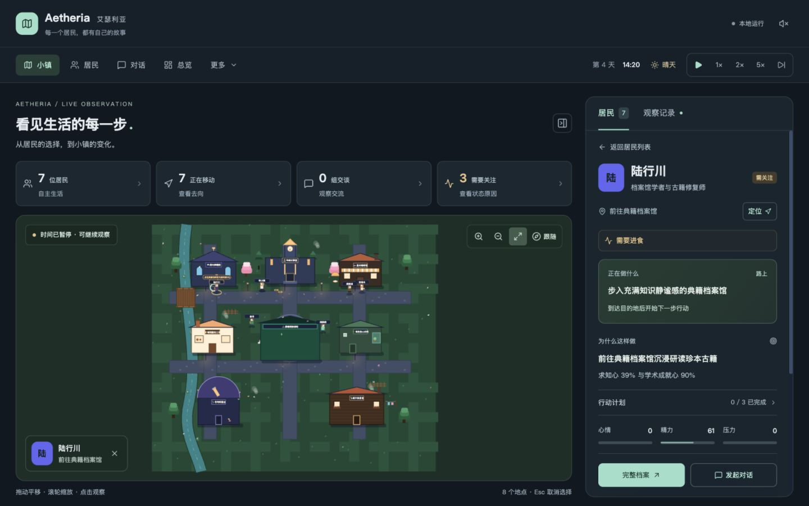
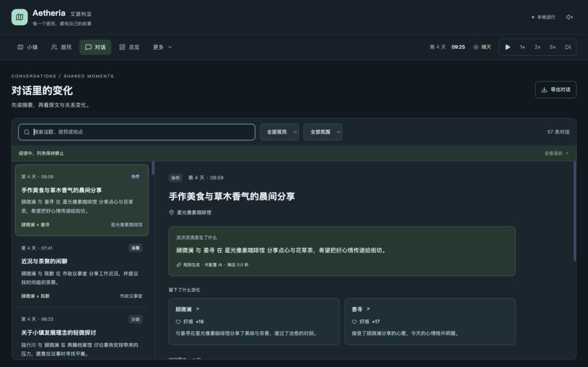
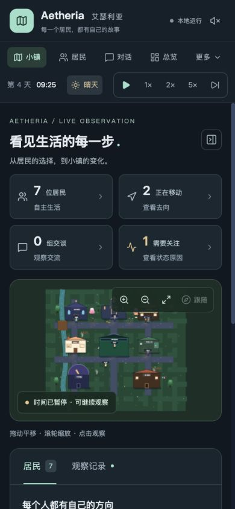

# AI-Town 体验与可观察性升级

首页现在围绕「正在做什么、为什么这样做、执行到哪一步、最近有什么变化」组织信息；对话页先展示摘要和结果，再提供原文阅读。既有居民、经济、信息传播与管理入口仍可使用。

## 本轮可观察性与阅读体验

- 地图上方提供居民、移动、交谈和需关注摘要。点击摘要可直接筛选；居民列表显示行动、去向和状态，支持姓名、职业、目标搜索。
- 选中居民后进入专注详情：当前行动、目标动机、行动进度、可展开计划、心情/精力/压力和最近变化。隐藏效用评分的内部加权术语，保留原始目标数据。
- 行路过程中展示去向，抵达后才展示行动进度。居民位置按照地图坐标判断，避免把上一个地点当成当前地点。
- 观察记录捕获目标切换/完成、行动完成、状态关注/恢复，并合并对话和事件。按类型和居民筛选；完成行动附带该次模拟更新的净数值变化，包含自然消耗。
- 目标、行动与状态记录在应用内保留最近 120 条，切换页面仍保留；刷新页面后重新开始。观察面板保存当前阅读快照，新变化通过按钮更新，不挤动正在读的记录。面板最多同时显示 60 条摘要，完整对话仍有独立入口。
- 对话页使用桌面左右阅读布局、手机列表/详情切换。支持话题、姓名、地点搜索和居民/氛围筛选；先读摘要、生成来源、好感变化和记忆，再看逐句原文。较早对话按需加载。
- 对话明确区分 AI 生成、服务端规则生成、客户端备用对话；记录原因与请求耗时。旧记录显示「来源未记录」。修复规则结果误记为 Gemini 成功、非配额错误误记为超限、规则生成被统计为模型 RPM/TPM 等问题。模型 token 数仍为成功响应的文本估算，配额配置仍需按实际项目核对。
- 好感变化使用实际写入的关系投影与交谈前数值之差；提示不再写死为 +5。发起交谈保留选中居民，选择最近的空闲邻居，并立即停止参与者移动。对话显示准备、播放、完成阶段与进度。
- 修复备用对话的随机乱序和空句，保留脚本问答顺序。摘要描述交流内容；历史中的空句跳过显示。
- 地图提供平滑定位、跟随、围绕缩放点的缩放、选中居民的目标路线。手动拖动可停止跟随；改变窗口大小保留手动视角；支持键盘和减少动态效果设置。
- 首页与对话页统一深色背景、薄荷色重点、留白、状态色和字号；手机阅读详情时收起搜索栏，并提供固定返回入口。

## 同一 PR 中已完成的模拟与导航修复

- 十个并列导航整理为「小镇、居民、对话、总览」，其余六项工具放入「更多」。
- 引擎每 200ms 推进 1 个模拟分钟，1× 下每秒推进 5 个模拟分钟；居民行走由 speed × 2.2 像素/秒调整为 speed × 30 像素/秒，同一 speed 下约提高 13.6 倍，显示使用插值。
- 修复跨午夜快进、午夜小时解析、旧计划状态被直接修改、移动越过目标等问题。暂停后恢复原倍速。
- 画布使用稳定动画循环、窗口与 Retina 适配、触屏拖动、拖动后防误选。
- 自动交谈触发移出 React 状态更新函数，使用最新上下文；保持 15 秒真实时间冷却。对话请求 12 秒超时，其他 AI 请求 20 秒超时；第一句立即显示。
- 大型本地状态每秒最多保存一次，并在离开时保存最新状态；存储异常不会中断模拟。高级页面与导出弹窗按需加载。
- 增加可选 VITE_DISABLE_CLOUD_SYNC=true 隔离本地验证，默认仍保持云同步。

## 验证结果

- TypeScript 检查、生产构建、Git diff 空白检查通过。
- 18 项测试通过：模拟时间/移动/不可变快照/结算/插值，以及观察去噪、目标原因、行动变化、状态越界与恢复、来源标记、错误分类、备用对话顺序。
- 完整 Express + Vite 本地应用验证；8 次无 AI 凭据的对话 API 请求均返回 HTTP 200、4 个非空 ABAB 语句、明确备用来源，模型 RPM/TPM 为 0。
- 桌面 1440×900、手机 390×844 布局检查完成，页面没有横向溢出。验证了搜索、筛选、计划展开、定位、跟随、保留选中的交谈、来源/好感显示，以及手机对话详情与返回。
- 阅读观察列表期间新增 130 条变化，原列表保持一致；点击「查看最新」后更新。
- 前一轮还验证了全部六个工具页、暂停后恢复 5×、24 次快进正确跨天与本地时钟重新载入。
- 同一依赖下正常云同步构建：首页 JS 由原 main 的 1169.93 kB 降至 966.55 kB（约 -17%），gzip 由 346.18 kB 降至 298.58 kB（约 -14%）。仍有大包提示；没有据此推断实际首屏耗时或 FPS。
- 本地使用隔离云同步模式，未调用真实 Gemini。真实模型延迟、配额和部署后的云同步需进一步验证；模拟需求与行动现在随时钟同步，较长运行的生活平衡仍需调整。

## 预览






## 接下来优先升级

1. **居民完整档案、总览、经济与信息传播页。** 使用同一视觉规范，先给出摘要与主要变化，再展开专业指标；总览增加有解释的趋势和异常入口。
2. **可回放的历史。** 当前观察日志为会话内记录；进一步保存结构化事件、状态快照和决策依据，支持按模拟时间回看，关联事件、对话、需求与行动结果。
3. **居民决策与交流质量。** 让严重疲劳、饥饿及时打断旧计划；改善反复行动和重复话题，精简提示上下文、去重请求并增加队列。需要通过长时间运行测量，而非仅看动画速度。
4. **身份、数据归属与权威模拟。** 当前 Firestore 业务集合权限较宽，simulation_state/current 为全局共享。应增加用户/小镇归属，并由一个权威实例推进世界；涉及 Firebase 数据迁移与部署，单改仓库文件不足以完成。
5. **运行指标与规模。** AI 接口需应用鉴权和调用者限流；模型/配额应可配置，接入实际 token 用量。更多居民时测量主线程耗时，再考虑空间索引、Worker 与地图静态缓存。

## 运行与交付

```sh
bun install
bun run dev
bun run lint
bun run test
bun run build
```

测试脚本需要 Node.js；本次使用 Node.js 24.19.0。完整应用运行在端口 3000。本地隔离模式在 .env.local 中设置 VITE_DISABLE_CLOUD_SYNC=true；真实模型使用已有 GEMINI_API_KEY 配置。

改动持续提交到 PR #1 的独立分支。GitHub 权限无需更改；PR 尚未合并，部署环境尚未更新。服务端的来源与统计修复需要一并部署 server.ts。
